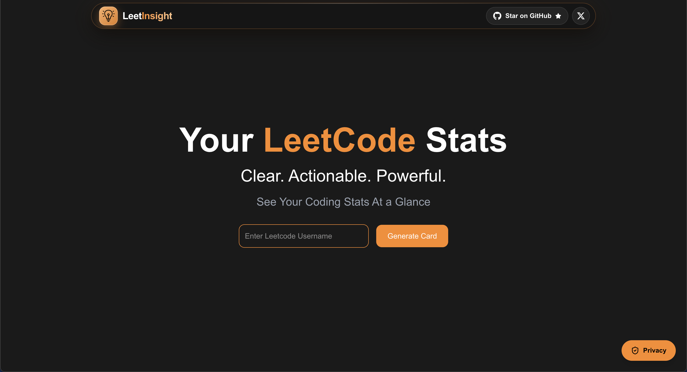
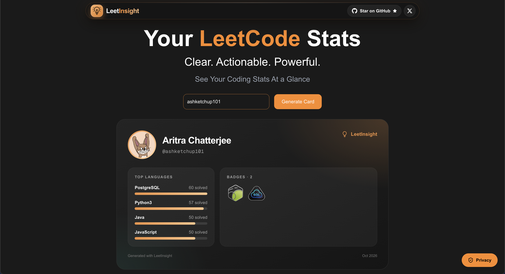
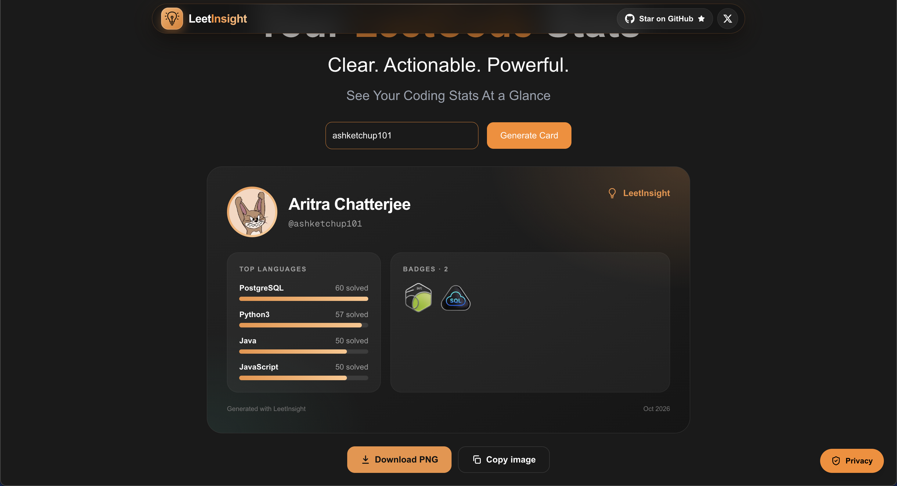
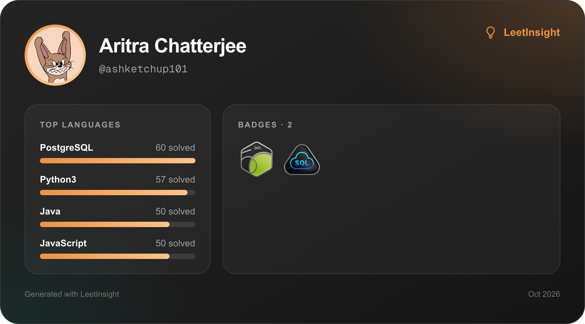
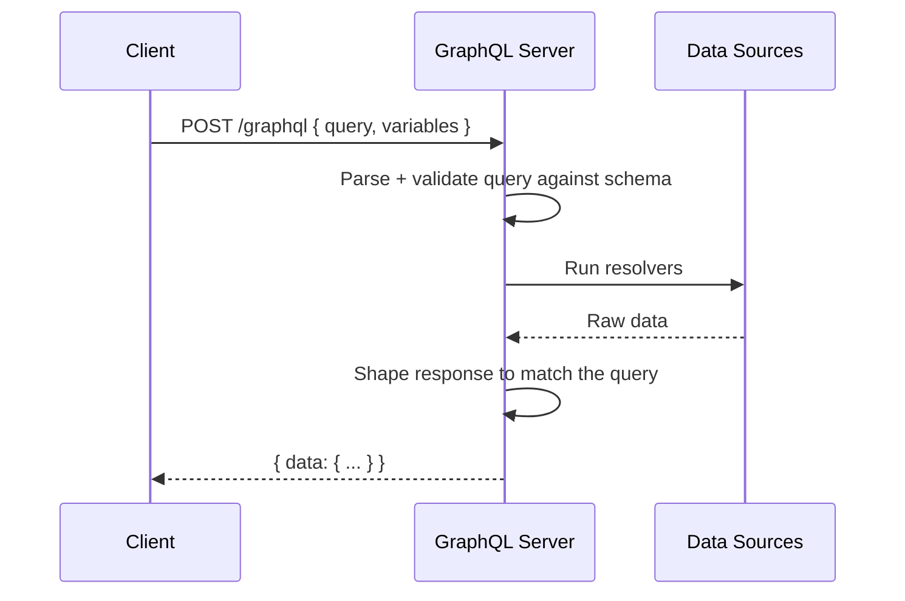
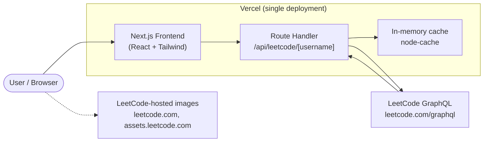
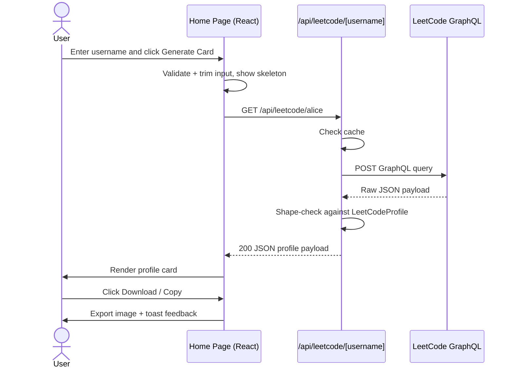
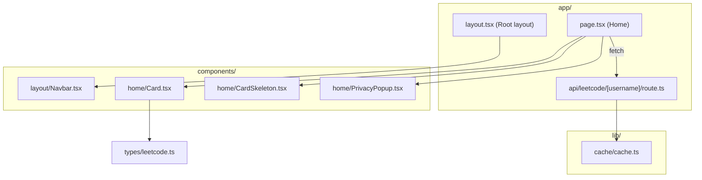

# LeetInsight

> A LeetCode profile card generator. Enter a username, get a polished, downloadable card you can share on GitHub, LinkedIn, and your portfolio.

LeetInsight is a single-page Next.js app that reads public LeetCode profile data, renders a clean profile card (top languages and badges), and lets users download or copy the card as an image. The frontend and API logic live in the same repository and deploy as one Vercel project.



---

## Demo

| Card Search                            | Download Option                                  | Downloaded Image                        |
| -------------------------------------- | ------------------------------------------------ | --------------------------------------- |
|   |       |  |

---

## Table of Contents

1.  [Product Overview](#1-product-overview)
2.  [Tech Stack](#2-tech-stack)
3.  [What is GraphQL?](#3-what-is-graphql)
4.  [How LeetInsight Uses LeetCode's GraphQL API](#4-how-leetinsight-uses-leetcode-s-graphql-api)
5.  [High-Level Design (HLD)](#5-high-level-design-hld)
6.  [Low-Level Design (LLD)](#6-low-level-design-lld)
7.  [Project Structure](#7-project-structure)
8.  [Getting Started](#8-getting-started)
9.  [Configuration](#9-configuration)
10. [Deployment](#10-deployment)
11. [Privacy](#13-privacy)

---

## 1. Product Overview

```text
LeetCode Username
       ↓
Next.js app
       ↓
/api/leetcode/[username]
       ↓
LeetCode GraphQL API
       ↓
Profile-shaped JSON (fields limited by the query)
       ↓
Render card + export image
```

### Home page layout

```text
Navbar (fixed floating pill, rendered in app/layout.tsx)
  ├── LeetInsight brand (click scrolls to top on the home page)
  ├── "Star on GitHub" link
  └── X link

Hero
  ├── "Your LeetCode Stats"
  ├── "Clear. Actionable. Powerful."
  └── username input + Generate Card button

Loading skeleton (mimics the card while fetching)

Result card
  ├── avatar
  ├── display name / @username
  ├── Top Languages (bar list, top 4)
  ├── Badges (grid of icons with a "+N" overflow tile)
  └── Download PNG / Copy image actions + toast feedback

Privacy button (bottom-right) → in-app privacy policy popup
```

### Explicit non-goals

- No authentication or user accounts
- No database or persistent profile storage
- No separate Express or custom backend service
- No social login, saved history, or dashboard

---

## 2. Tech Stack

| Layer          | Technology                                        |
| -------------- | ------------------------------------------------- |
| Framework      | Next.js 16 (App Router)                           |
| Language       | TypeScript                                        |
| UI             | React 19                                          |
| Styling        | Tailwind CSS 4                                    |
| API client     | Axios                                             |
| Image export   | `html-to-image` (PNG + clipboard blob)            |
| Caching        | `node-cache`                                      |
| Icons          | `lucide-react`, `react-icons`                     |
| Hosting        | Vercel                                            |

---

## 3. What is GraphQL?

**GraphQL** is a query language for APIs and a runtime that executes those queries. Instead of a server deciding exactly what every endpoint returns, the client specifies the fields it needs and the server responds with only that shape.

### REST vs. GraphQL

| Aspect          | REST                                         | GraphQL                                         |
| --------------- | -------------------------------------------- | ----------------------------------------------- |
| Endpoints       | Many (`/users/1`, `/users/1/badges`, ...)    | Typically one (`/graphql`)                      |
| Response shape  | Fixed by the server                          | Chosen by the client query                      |
| Over-fetching   | Common                                       | Avoided                                         |
| Under-fetching  | Common                                       | Avoided                                         |
| Typing          | Optional                                     | Built in                                        |

### Core concepts

- **Schema** – a typed contract for the API's objects and fields.
- **Query** – a read request for data.
- **Mutation** – a write request (not used here).
- **Variables** – values passed separately from the query text, such as `$username`.
- **Resolvers** – server-side logic that gathers the requested data.

### How a GraphQL request works



1. The client sends a single HTTP `POST` with a `query` string and optional `variables`.
2. The server validates the query against its schema.
3. The server resolves each requested field.
4. The server returns JSON whose structure matches the query.

### A tiny example

Query:

```graphql
query ($username: String!) {
  matchedUser(username: $username) {
    username
    profile {
      realName
      userAvatar
    }
  }
}
```

Variables:

```json
{ "username": "alice" }
```

Response:

```json
{
  "data": {
    "matchedUser": {
      "username": "alice",
      "profile": {
        "realName": "Alice",
        "userAvatar": "https://..."
      }
    }
  }
}
```

> Note: GraphQL can return HTTP `200` even when the response contains `errors`. The app checks the response body (`matchedUser` is `null` for unknown users), not just the status code.

---

## 4. How LeetInsight Uses LeetCode's GraphQL API

LeetCode exposes a public GraphQL API at:

```text
POST https://leetcode.com/graphql
```

LeetInsight sends a request from the server using the provided username and asks only for the fields needed to render the profile card: display name, avatar, language solve counts, and badges.

The query used by the app (`app/api/leetcode/[username]/route.ts`):

```graphql
query getUserProfile($username: String!) {
  matchedUser(username: $username) {
    username
    profile {
      realName
      userAvatar
    }
    languageProblemCount {
      languageName
      problemsSolved
    }
    badges {
      id
      name
      icon
      creationDate
    }
  }
}
```

Key points:

- The API call is made server-side in `app/api/leetcode/[username]/route.ts`, not in the browser — this avoids CORS problems and keeps the upstream logic in one place.
- The username is part of the route path: `/api/leetcode/<username>` (URL-encoded on the client).
- The query limits the response to exactly the `LeetCodeProfile` shape the UI consumes, so no extra transformation step is needed.
- If `matchedUser` is `null`, the app returns a `404` response and the user sees a validation message in the interface.

---

## 5. High-Level Design (HLD)

### 5.1 Architecture overview

```text
User enters username
      ↓
Next.js page (`app/page.tsx`)
      ↓
GET /api/leetcode/[username]
      ↓
LeetCode GraphQL API
      ↓
Profile JSON returned to the UI
      ↓
Render card with languages + badges
      ↓
Download / copy image
```

### 5.2 System context



### 5.3 Components at a glance

| Component             | Responsibility                                                                       |
| --------------------- | ------------------------------------------------------------------------------------ |
| **Frontend (React)**  | Renders the home screen, manages username input, loading skeleton, and the card      |
| **Route Handler**     | Validates the path param, fetches from LeetCode, and returns JSON                    |
| **Cache**             | Stores recent profile lookups for a short TTL                                        |
| **Card export**       | Converts the rendered card to a PNG or a clipboard image                             |
| **LeetCode GraphQL**  | Source of truth for public user profile data                                         |

### 5.4 Primary request flow



### 5.5 Data flow summary

1. The user inputs a LeetCode username.
2. The frontend trims and validates the input, shows a loading skeleton, then calls the app's API route with the URL-encoded username.
3. The route checks the in-memory cache.
4. If needed, it calls LeetCode GraphQL and returns the profile as JSON.
5. The UI renders the card with language stats and badges.
6. The card is exported to a PNG (downloaded) or copied to the clipboard, with toast feedback.

### 5.6 Statelessness

The application is intentionally stateless:

- No database
- No accounts
- No persistent storage of usernames
- No server-side session management

The only temporary storage is the in-memory cache used to reduce repeat LeetCode requests.

### 5.7 Caching strategy

| Layer         | What is cached              | Mechanism                              |
| ------------- | --------------------------- | -------------------------------------- |
| App runtime   | Recent profile responses    | `node-cache` with 5-minute TTL         |
| Browser       | UI state only               | React state, no persisted cache        |
| Static assets | JS, CSS, fonts, images      | Vercel static asset delivery           |

The cache is intentionally short-lived to avoid stale stats while still reducing redundant calls.

### 5.8 Non-functional considerations

- **Performance**: one outbound request per user lookup, with a short cache TTL.
- **Reliability**: failures are handled gracefully and surfaced to the user.
- **Security**: no secret keys are needed; the app only reads public LeetCode data.
- **Scalability**: stateless Next.js serverless functions scale well with Vercel.
- **Maintainability**: API-specific logic is kept in a small route with a few shared types.

---

## 6. Low-Level Design (LLD)

### 6.1 Module map



### 6.2 Responsibilities by file

| File                                        | Responsibility                                                                                    |
| ------------------------------------------- | ------------------------------------------------------------------------------------------------- |
| `app/page.tsx`                              | Home screen, username state, loading/error handling, card and privacy popup rendering             |
| `app/layout.tsx`                            | Root layout, fonts (Geist / Geist Mono), metadata, and the fixed Navbar                           |
| `app/api/leetcode/[username]/route.ts`      | Route handler for profile requests, GraphQL fetch, and cache logic                                |
| `components/layout/Navbar.tsx`              | Fixed floating pill navbar with scroll-aware styling and a scroll progress bar                    |
| `components/home/Card.tsx`                  | Full card rendering plus PNG export / clipboard copy with toast feedback                          |
| `components/home/CardSkeleton.tsx`          | Loading placeholder that mimics the card layout for a seamless swap                               |
| `components/home/PrivacyPopup.tsx`          | In-app privacy modal (Escape to close, background scroll locked)                                  |
| `lib/cache/cache.ts`                        | Short-lived in-memory cache for profile responses                                                 |
| `types/leetcode.ts`                         | Shared user/profile schema for the app                                                            |
| `next.config.ts`                            | Allows remote LeetCode image hosts for `next/image`                                               |


### 6.3 Response contract

| Status | Body                                    | Meaning                        |
| ------ | --------------------------------------- | ------------------------------ |
| `200`  | profile JSON                            | success                        |
| `404`  | `{ "error": "User not found" }`         | user not found on LeetCode     |
| `500`  | `{ "error": "Something went wrong" }`   | unexpected application error   |


While `loading` is true, the page renders `CardSkeleton` instead of the card.

### 6.4 Data model

The app uses a single shared shape for the card (`types/leetcode.ts`):

```ts
export interface LeetCodeProfile {
  username: string;
  profile: {
    realName: string | null;
    userAvatar: string;
  };
  languageProblemCount: {
    languageName: string;
    problemsSolved: number;
  }[];
  badges: {
    id: string;
    name: string;
    icon: string;
    creationDate: string;
  }[];
}
```

This keeps the UI decoupled from raw LeetCode JSON details, since the GraphQL query already limits the response to this shape.

### 6.5 Component contracts

```text
HomePage       props: none
Navbar         props: none
Card           props: { profile: LeetCodeProfile, stats?: CardStats }
CardSkeleton   props: none
PrivacyPopup   props: { isOpen: boolean, onClose: () => void }
```

- `HomePage` controls form submission, state transitions, and profile rendering.
- `Card` renders the final profile card and provides export actions.
  - `stats` is optional: when provided, the card shows a "Problems Solved" panel with a progress ring and Easy / Medium / Hard bars. The connection is not wired up yet (see [Limitations & Future Work](#12-limitations--future-work)).
- `CardSkeleton` mirrors the card's layout while data is loading.
- `PrivacyPopup` overlays the privacy policy without leaving the page (Escape closes it; body scrolling is locked while open).

### 6.6 Card layout details

The card is rendered at a fixed width of **880px** and scaled down with a `ResizeObserver` so the exported PNG is identical on every device:

- **Header**: gradient-ringed avatar (with a letter fallback if the avatar is missing), display name (`realName`, falling back to the username) and `@handle`.
- **Top Languages**: the top 4 languages sorted by solved count, each with a gradient bar.
- **Badges**: a grid showing up to 14 badges (2 rows of 7). Badges that fail to load or overflow collapse into a single `+N` tile so the total count stays honest.
- **Footer**: "Generated with LeetInsight" and the current month/year.
- Avoids `backdrop-blur` / `mix-blend` inside the exported node because they do not survive PNG export.

### 6.7 Download / export

The card export is performed directly in the browser using `html-to-image`:

- **Download PNG** renders the card with `toPng` at `pixelRatio: 2` and triggers a download named `leetinsight-<username>.png`.
- **Copy image** renders it with `toBlob` and writes a PNG to the clipboard. If the browser doesn't support clipboard images (e.g. Safari or Firefox without permissions), the app falls back to a toast suggesting Download instead.
- Buttons are disabled while an export is in progress, and a toast confirms success or failure.

This keeps the flow simple and avoids server-side image generation.

### 6.8 Validation rules

| Where  | Rule                                                                                     |
| ------ | ---------------------------------------------------------------------------------------- |
| Client | Trim whitespace; reject empty input; URL-encode the username in the request path          |
| Server | Route param is read from the awaited `params`; unknown users trigger a `404` response      |

The server remains the source of truth for user existence. Client validation only improves UX.

---

## 7. Project Structure

```text
LeetInsight/
│
├── app/
│   ├── api/
│   │   └── leetcode/
│   │       └── [username]/
│   │           └── route.ts
│   ├── favicon.ico
│   ├── globals.css
│   ├── layout.tsx
│   └── page.tsx
│
├── components/
│   ├── home/
│   │   ├── Card.tsx
│   │   ├── CardSkeleton.tsx
│   │   └── PrivacyPopup.tsx
│   └── layout/
│       └── Navbar.tsx
│
├── lib/
│   └── cache/
│       └── cache.ts
│
├── public/
│   ├── LandingPage.png
│   ├── CardSearch.png
│   ├── downloadCard.png
│   ├── Downloaded.png
│   ├── insight.png
│   └── *.svg                       # default Next.js starter assets (unused)
│
├── types/
│   └── leetcode.ts
│
├── .gitignore
├── AGENTS.md
├── CLAUDE.md
├── README.md
├── eslint.config.mjs
├── next.config.ts
├── package-lock.json
├── package.json
├── postcss.config.mjs
├── tsconfig.json
└── node_modules/
```

---

## 8. Getting Started

### Prerequisites

- Node.js (LTS version recommended)
- npm

### Install and run

```bash
git clone https://github.com/AritraC1/LeetInsight.git

cd LeetInsight

npm install

npm run dev
```

Open <http://localhost:3000>.

### Scripts

| Command           | Description                       |
| ----------------- | --------------------------------- |
| `npm run dev`     | Start the local dev server        |
| `npm run build`   | Create a production build         |
| `npm run start`   | Run the production build          |
| `npm run lint`    | Lint the project with ESLint      |

### Try the API directly

```bash
curl "http://localhost:3000/api/leetcode/your_username"
```

Replace `your_username` with a valid LeetCode handle.

---

## 9. Configuration

No environment variables or secrets are required for the core app flow. The app reads public LeetCode profile data and does not require database credentials, authentication keys, or a backend service.

The key configuration is the remote image allowlist in `next.config.ts` so `next/image` can fetch LeetCode avatars and badges safely.

---

## 10. Deployment

The whole application deploys as a single Vercel project:

```text
GitHub
   ↓
Vercel
   ↓
Next.js app
   ├── frontend UI
   ├── API route
   └── static assets
          ↓
     LeetCode GraphQL
```

1. Push the repository to GitHub.
2. Import the repository into Vercel.
3. Deploy the project.

> Vercel automatically detects the Next.js app; no extra server management is required.

---

## 11. Privacy

LeetInsight does not require accounts, a database, or persistent profile storage. It reads public LeetCode data for the current request and renders it in the browser. The in-memory cache is short-lived and exists only to reduce duplicated API calls. An in-app privacy popup (bottom-right button) explains this policy to users.

---
